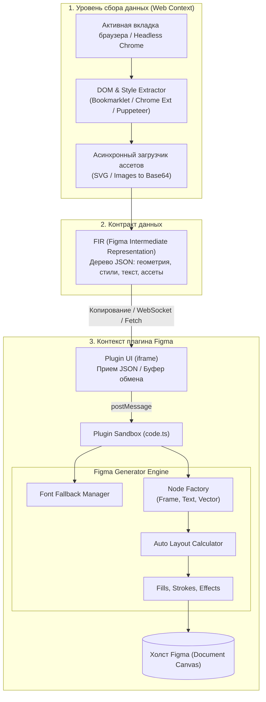
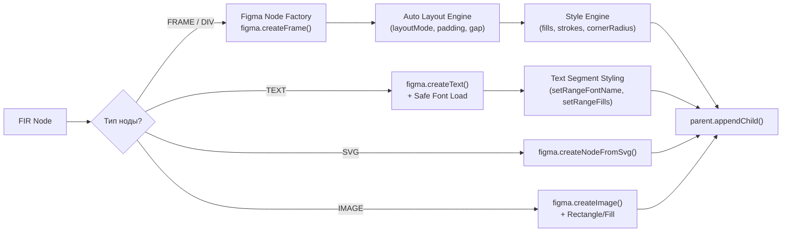
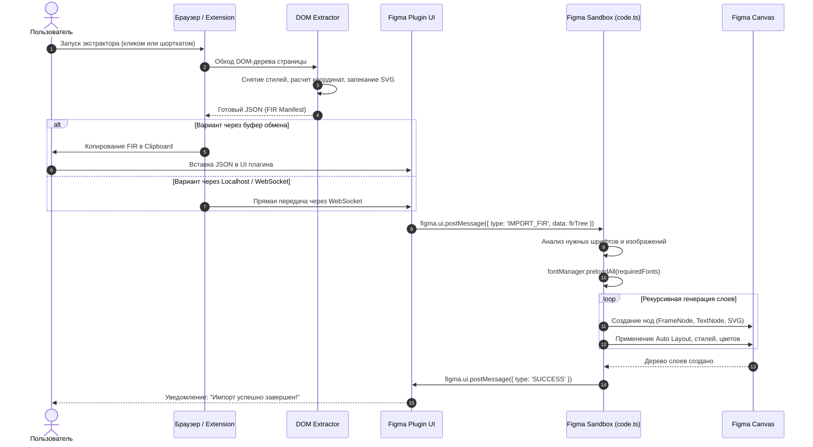

# Архитектурный план: HTML to Figma Engine (maxim4design)

Данный документ описывает целевую архитектуру, спецификацию промежуточного контракта данных (FIR — Figma Intermediate Representation), устройство модулей экстракции и рендеринга, а также фазы реализации внутреннего движка **maxim4design**.

---

## Содержание
1. [Общие цели и принципы системы](#1-общие-цели-и-принципы-системы)
2. [Высокоуровневая архитектура (High-Level Design)](#2-высокоуровневая-архитектура-high-level-design)
3. [Спецификация контракта данных (FIR — Figma Intermediate Representation)](#3-спецификация-контракта-данных-fir)
4. [Детальное устройство модулей](#4-детальное-устройство-модулей)
   - [4.1. Модуль экстракции (DOM & Style Extractor)](#41-модуль-экстракции-dom--style-extractor)
   - [4.2. Модуль рендеринга (Figma Node Generator)](#42-модуль-рендеринга-figma-node-generator)
5. [Последовательность взаимодействия (Sequence Diagram)](#5-последовательность-взаимодействия-sequence-diagram)
6. [Стратегия отказоустойчивости (Fault Tolerance)](#6-стратегия-отказоустойчивости-fault-tolerance)
7. [План фаз реализации (Implementation Roadmap)](#7-план-фаз-реализации-implementation-roadmap)

---

## 1. Общие цели и принципы системы

### Ключевые цели
* **Редактируемость результата:** Создавать не просто растровую копию сайта, а нативные слои Figma с использованием **Auto Layout** (где применимо), векторных SVG и редактируемого текста.
* **Работа в любых окружениях:** Поддержка импорта как публичных сайтов по URL, так и локальных стендов (`localhost`), а также страниц под авторизацией через браузерное расширение/скрипт.
* **Изолированность компонентов:** Полное разделение этапа извлечения данных из веб-страницы (DOM-парсер) и этапа генерации слоев внутри Figma (Figma Plugin Engine).

### Принципы архитектуры
1. **Single Source of Truth:** Промежуточный JSON-манифест (FIR) самодостаточен — плагину Figma не требуется повторно обращаться в интернет за стилями.
2. **Graceful Degradation:** Если сложное CSS-свойство невозможно перевести в Auto Layout (например, сложный CSS Grid), система переключается на абсолютное позиционирование, сохраняя визуальную точность.
3. **Fail-Safe типографика:** Ошибки загрузки веб-шрифтов никогда не должны блокировать генерацию интерфейса (строгие fallback-цепочки).

---

## 2. Высокоуровневая архитектура (High-Level Design)

Система делится на три независимых уровня: **Сбор данных**, **Транспорт/Контракт** и **Рендеринг в Figma**.



---

## 3. Спецификация контракта данных (FIR)

Промежуточное представление (FIR Node) описывает дерево элементов независимо от ограничений Figma API.

### Базовая схема узла (TypeScript интерфейс)

```typescript
export type FIRNodeType = 'FRAME' | 'TEXT' | 'VECTOR' | 'IMAGE' | 'RECTANGLE';

export interface FIRNode {
  id: string;
  name: string;
  type: FIRNodeType;
  
  // Геометрия в пикселях (экранные абсолютные координаты)
  bounds: {
    x: number;
    y: number;
    width: number;
    height: number;
  };

  // Параметры отображения и видимости
  visible: boolean;
  opacity: number;
  clipsContent: boolean; // overflow: hidden

  // Параметры Auto Layout (если применимо)
  layout?: {
    mode: 'NONE' | 'HORIZONTAL' | 'VERTICAL';
    wrap: boolean;
    itemSpacing: number;
    padding: {
      top: number;
      right: number;
      bottom: number;
      left: number;
    };
    primaryAlign: 'MIN' | 'CENTER' | 'MAX' | 'SPACE_BETWEEN';
    counterAlign: 'MIN' | 'CENTER' | 'MAX' | 'BASELINE';
  };

  // Стилизация формы
  style?: {
    backgroundColor?: RGBAColor;
    borderRadius?: {
      topLeft: number;
      topRight: number;
      bottomRight: number;
      bottomLeft: number;
    };
    borders?: {
      top: BorderStyle;
      right: BorderStyle;
      bottom: BorderStyle;
      left: BorderStyle;
    };
    shadows?: ShadowEffect[];
    blur?: number;
  };

  // Специфика для текста
  textData?: {
    characters: string;
    segments: TextSegment[]; // Для инлайн-стилей внутри одного блока
  };

  // Специфика для векторной графики / SVG
  svgContent?: string;

  // Специфика для растровых картинок
  imageData?: {
    base64: string;
    scaleMode: 'FILL' | 'FIT' | 'CROP';
  };

  // Иерархия
  zIndex: number;
  children?: FIRNode[];
}

export interface RGBAColor {
  r: number; // 0..1
  g: number; // 0..1
  b: number; // 0..1
  a: number; // 0..1
}

export interface TextSegment {
  start: number;
  end: number;
  fontFamily: string;
  fontWeight: number;
  fontSize: number;
  lineHeightPx?: number;
  letterSpacingPx?: number;
  color: RGBAColor;
  textDecoration?: 'NONE' | 'UNDERLINE' | 'STRIKETHROUGH';
}
```

---

## 4. Детальное устройство модулей

### 4.1. Модуль экстракции (DOM & Style Extractor)

Экстрактор запускается в контексте браузера и состоит из 5 ключевых подмодулей:

1. **Tree Sanitizer & Filter:**
   * Пропускает теги `<script>`, `<style>`, `<noscript>`, `<template>`.
   * Игнорирует элементы с `display: none` или нулевыми размерами (`width === 0 && height === 0` без видимого контента).
2. **Computed Style Parser:**
   * Считывает `window.getComputedStyle(element)`.
   * Нормализует цвета: строковые значения (`#fff`, `rgba(0,0,0,0.5)`, `hsl(...)`) преобразуются в унифицированный объект `RGBA (0..1)`.
   * Преобразует `box-shadow` в массив структурированных объектов теней.
3. **Layout Analyzer (Детектор Flexbox / Grid):**
   * Если `display: flex` / `inline-flex`: считывает направление (`flex-direction`), промежутки (`gap`), отступы (`padding`), выравнивание (`justify-content`, `align-items`).
   * Если `display: grid` или элементы со сложным абсолютным позиционированием: помечает узел флагом `layout.mode = 'NONE'` для включения абсолютного позиционирования детей.
4. **Text & Range Builder:**
   * Обрабатывает текстовые узлы с сохранением единого контейнера.
   * Вычисляет смещения символов (`start`, `end`) для тегов `<b>`, `<strong>`, `<a>`, `<span>`.
5. **Asset Serializer:**
   * **SVG:** Запекает цвет (резолвит `currentColor`), нормализует viewBox и сериализует в чистый SVG-код.
   * **IMG / Background:** Выкачивает картинку, конвертирует в Base64 через `<canvas>` или `fetch(blob)`.

---

### 4.2. Модуль рендеринга (Figma Node Generator)

Работает в изолированном песочном потоке Figma (`code.ts`):



#### Ключевые сервисы движка Figma:
* **FontLoader Service:**
  * Содержит кэш предзагруженных шрифтов.
  * Если шрифт не загрузился за таймаут или отсутствует, плавно откатывается на безопасный шрифт (`Inter` или `Roboto`).
* **AutoLayout Engine:**
  * Устанавливает `layoutMode`, `primaryAxisAlignItems`, `counterAxisAlignItems`.
  * Если у ребенка в вебе задан фиксированный размер — устанавливает `layoutSizingHorizontal = 'FIXED'`. Если тянется — `'FILL'` или `'HUG'`.
* **Stacking Context Manager:**
  * Сортирует список детей узла по `zIndex` перед вызовом `appendChild`, гарантируя визуальную точность наложения слоев.

---

## 5. Последовательность взаимодействия (Sequence Diagram)



---

## 6. Стратегия отказоустойчивости (Fault Tolerance)

| Возможный сбой | Причина | Стратегия обработки (Fallback) |
| :--- | :--- | :--- |
| **Шрифт не существует в Figma** | Кастомный веб-шрифт (`.woff2`) | Обертка в `try/catch`. При ошибке шрифт заменяется на `Inter` (Regular/Bold), в консоль пишется предупреждение. |
| **CORS блокировка картинок** | Сервер картинок запрещает чтение через Canvas | Использование проксирующего URL или создание плейсхолдера с серым фоном и сохранением точных размеров. |
| **SVG с ошибками синтаксиса** | `figma.createNodeFromSvg` бросает исключение | Перехват ошибки: рендеринг SVG в `<canvas>` в браузере и передача в Figma как растрового PNG. |
| **Сложный Grid / абсолютные элементы** | Figma Auto Layout не может выразить раскладку | Установка `layoutMode = "NONE"`. Дочерние элементы позиционируются по абсолютным координатам `(x, y)`. |
| **Гигантский DOM (> 10 000 нод)** | Зависание песочницы Figma Plugin API | Пакетный (Chunked) рендеринг через `requestAnimationFrame` или `setTimeout` с прогресс-баром в UI. |

---

## 7. План фаз реализации (Implementation Roadmap)

### Фаза 1: Proof of Concept (PoC) — Минимальный вертикальный срез
* [x] Анализ репозиториев и формирование базы знаний ([KNOWLEDGE_BASE.md](file:///e:/Projects/Dev/html2design/KNOWLEDGE_BASE.md)).
* [ ] Разработка каркаса Figma-плагина (`manifest.json`, `ui.html`, `code.ts`).
* [ ] Реализация консольного скрипта-экстрактора для извлечения одного прямоугольника с текстом.
* [ ] Базовый импорт: создание `FrameNode` и `TextNode` с цветом фона и шрифтом `Inter`.

### Фаза 2: Раскладка и типографика (Auto Layout & Typography)
* [ ] Алгоритм маппинга Flexbox в Auto Layout (`layoutMode`, `gap`, `padding`, `alignment`).
* [ ] Сервис безопасной предзагрузки шрифтов (`safeLoadFont` с fallback-цепочкой).
* [ ] Поддержка инлайн-диапазонов текста (`setRangeFontName`, `setRangeFills`).
* [ ] Обработка скруглений (`cornerRadius`) и рамок (`borders`).

### Фаза 3: Векторная графика и медиа (Assets & Visuals)
* [ ] Обработка и нормализация SVG (`currentColor` -> вычисленный hex).
* [ ] Поддержка растровых изображений (`figma.createImage` из Base64/Uint8Array).
* [ ] Парсер теней `box-shadow` (внешние и внутренние тени).
* [ ] Снятие псевдоэлементов (`::before` / `::after`).

### Фаза 4: Автоматизация и UX (Extension & Polish)
* [ ] Создание Chrome Extension для захвата страницы в 1 клик.
* [ ] Оптимизация производительности (порционная генерация больших страниц).
* [ ] UI плагина с настройками (выбор вьюпорта, переключатель Auto Layout / Absolute).
