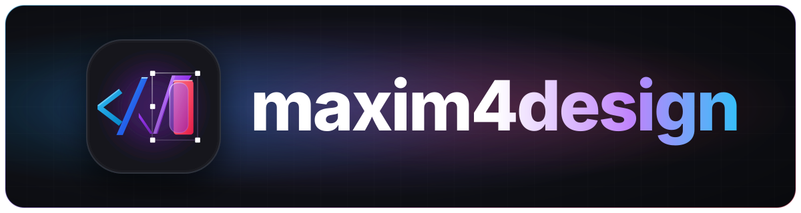

<p align="center">
  
</p>

> **maxim4design** (от *«Максим — для дизайна»*) — внутренний инструмент, написанный для того, чтобы переводить веб-вёрстку в редактируемые слои Figma без платных подписок за $20/мес. Название отражает суть проекта: авторская разработка для ускорения командных задач.

---

## 🎯 Зачем этот проект?

Коммерческие плагины-конвертеры требуют ежемесячной оплаты ($15–$20/мес за пользователя) и накладывают ограничения на локальные стенды (`localhost`) и закрытые контуры.

**maxim4design** решает эту проблему:
* **0₽ / Без подписок:** Полностью бесплатный и автономный инструмент.
* **Работает везде:** Снимает верстку прямо из браузера (включая `localhost:3000`, внутренние корпоративные порталы и админки под авторизацией).
* **Нативный результат:** Генерирует редактируемый текст, векторные SVG-иконки и фреймы с **Auto Layout**, а не плоские скриншоты.

---

## 🏗 Архитектура системы

Процесс конвертации состоит из двух независимых этапов:

```
[ Браузер (активная вкладка / DevTools) ]
                    │
                    ▼
          DOM & Style Extractor
(снимает вычисленные стили, геометрию, запекает SVG и цвета)
                    │
                    ▼
     FIR (Figma Intermediate Representation)
              [JSON-манифест]
                    │
                    ▼
       Плагин Figma (maxim4design)
(загружает шрифты, настраивает Auto Layout, создает слои на холсте)
```

---

## 🚀 Быстрый старт

### 1. Установка зависимостей и сборка

```bash
# Установка зависимостей
npm install

# Разовая сборка
npm run build

# Режим разработки с автопересборкой
npm run watch
```

После сборки в папке `dist/` появятся готовые файлы:
* `dist/code.js` — код песочницы плагина Figma
* `dist/ui.html` — интерфейс плагина
* `dist/extractor.js` — браузерный экстрактор для консоли или расширения

### 2. Запуск плагина в Figma

1. Откройте **Figma Desktop**.
2. Перейдите в меню: `Plugins` → `Development` → `Import plugin from manifest...`.
3. Выберите файл [`manifest.json`](manifest.json) из корня этого репозитория.
4. Плагин **maxim4design** появится в списке ваших плагинов разработки!

---

## 📚 Документация проекта

* **[ARCHITECTURE.md](ARCHITECTURE.md)** — Подробный архитектурный план, схемы потоков данных и TypeScript-спецификация формата данных FIR.
* **[KNOWLEDGE_BASE.md](KNOWLEDGE_BASE.md)** — База знаний: открытые репозитории-аналоги, каталог известных багов (шрифты, `currentColor`, Flexbox/Grid) и готовые технические решения.
* **[AGENTS.md](AGENTS.md)** — Регламент ведения задач и правила для AI-агентов.
* **[tasks/](tasks/)** — Карточки активных задач по фазам разработки.
* **[done/](done/)** — Архив выполненных и проверенных задач.

---

## 📄 Лицензия

Разрешено использовать всем бесплатно и без ограничений с личного разрешения разработчика.
